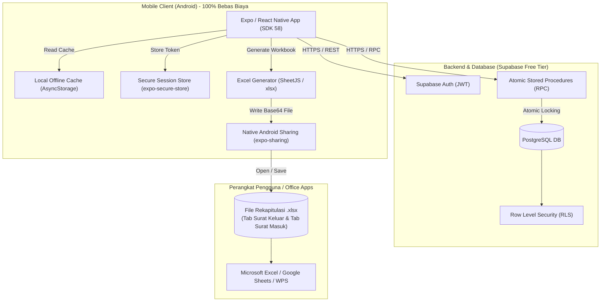

# Surat-in 📬

**Sistem Penomoran Otomatis & Sirkulasi Surat Organisasi Kemahasiswaan**  
Proyek Akhir Mata Kuliah Pemrograman Berbasis Platform (INF2528)  
Program Studi Informatika, Universitas Islam Negeri K.H. Abdurrahman Wahid Pekalongan

---

## 📌 Ringkasan Proyek

**Surat-in** adalah aplikasi mobile berbasis React Native (Expo) dan backend serverless Supabase PostgreSQL yang dirancang untuk mengatasi permasalahan pencatatan manual surat di organisasi kemahasiswaan:
1. **Pencegahan Nomor Surat Ganda:** Penomoran dihitung atomik di database PostgreSQL (`SECURITY DEFINER` Stored Procedure dengan row locking), bukan di aplikasi mobile.
2. **Standardisasi Format Sesuai Pedoman:** Mendukung Format Lembaga (7 bagian) dan Format Kepanitiaan (9 bagian, nomor urut kepanitiaan mulai dari 02).
3. **Pencatatan Surat Masuk & Deteksi Duplikasi:** Penomoran agenda masuk otomatis, validasi tanggal terhadap zona waktu server Indonesia (WIB), serta deteksi cerdas surat serupa untuk opsi pembaruan bentuk surat (*Softfile & Hardfile*) pada baris yang sama.
4. **Isolasi Lembaga & Mode Arsip:** Setiap lembaga hanya dapat mengakses surat miliknya sendiri (Row Level Security). Periode kepengurusan lampau otomatis berstatus hanya-baca (*read-only*).
5. **Ekspor Rekapitulasi Excel (.xlsx) Bebas Biaya:** Seluruh data surat keluar dan masuk dapat diekspor secara instan ke file Excel multi-tab (Surat Keluar & Surat Masuk) menggunakan SheetJS dan native sharing Android tanpa memerlukan akun Google Cloud berbayar atau kartu kredit.
6. **Ketahanan Akses Offline:** Daftar surat terakhir disimpan di penyimpanan lokal (`AsyncStorage`) sehingga tetap dapat dibaca tanpa sambungan internet.

---

## 🏗 Arsitektur Sistem



---

## 🛠 Stack Teknologi

- **Mobile Framework:** [React Native 0.88.1](https://reactnative.dev/) dengan [Expo SDK 58](https://expo.dev/)
- **Bahasa:** [TypeScript 5.9](https://www.typescriptlang.org/) (Strict Mode)
- **Navigasi & Routing:** [Expo Router v54](https://docs.expo.dev/router/introduction/) (File-based routing)
- **State & Context:** React 19 Context API (`AuthContext`)
- **Penyimpanan Lokal:** `expo-secure-store` (kredensial terenkripsi) & `@react-native-async-storage/async-storage` (cache offline)
- **Database & Auth:** [Supabase Free Tier](https://supabase.com/) (PostgreSQL 15, PostgREST, Row Level Security)
- **Ekspor Dokumen:** [SheetJS (xlsx)](https://docs.sheetjs.com/), `expo-file-system`, & `expo-sharing` (Ekspor Excel lokal tanpa server)
- **Testing:** Node.js Native Test Runner (`node:test`, `node:assert/strict`)

---

## 📂 Struktur Direktori

```text
surat-in/
├── app.json                          # Konfigurasi native Expo & Android package
├── eas.json                          # Profil EAS Build (preview APK & production AAB)
├── eslint.config.js                  # Konfigurasi ESLint 9 Flat Config
├── tsconfig.json                     # Konfigurasi TypeScript strict
├── blueprint-sirkulasi-surat.md      # Spesifikasi arsitektur master
├── docs/                             # Dokumentasi teknis & kepatuhan
│   ├── due-diligence.md              # Laporan kelayakan & kuota free-tier
│   ├── google-sheets-setup.md        # Panduan deployment Edge Function & Google Service Account
│   ├── security-audit.md             # Matriks kepatuhan OWASP Mobile & API
│   └── demo-guide.md                 # Naskah pengujian langsung 30 FR
├── src/
│   ├── __tests__/                    # Unit test suite
│   ├── app/                          # Layar Expo Router
│   │   ├── _layout.tsx               # Root provider & proteksi rute
│   │   ├── login.tsx                 # Layar autentikasi lembaga
│   │   ├── (tabs)/                   # 5 Tab utama navigasi
│   │   │   ├── index.tsx             # Beranda & status periode
│   │   │   ├── keluar/               # Modul surat keluar (buat, daftar, detail, edit)
│   │   │   ├── masuk/                # Modul surat masuk (catat, daftar, detail, edit)
│   │   │   ├── arsip.tsx             # Penelusuran arsip periode lampau (read-only)
│   │   │   └── akun.tsx              # Profil lembaga & ganti password
│   │   └── admin/                    # Panel pengelola (role: admin)
│   │       ├── index.tsx             # Dashboard ringkasan
│   │       ├── periode.tsx           # Kelola & ganti periode aktif
│   │       └── lembaga.tsx           # Kelola 67 institusi kemahasiswaan
│   ├── contexts/                     # AuthContext & Session management
│   ├── lib/                          # Supabase client singleton & SecureStore adapter
│   ├── types/                        # Definisi TypeScript untuk skema database
│   └── utils/                        # Utilitas format surat & cache offline
└── supabase/
    ├── migrations/                   # Skrip DDL database (skema, RLS, RPC, antrean)
    ├── seed.sql                      # Data awal (67 lembaga, jenis surat, penandatangan)
    ├── functions/                    # Deno Edge Functions
    │   └── sync-sheets/              # Sinkronisasi asinkron ke Google Sheets
    └── tests/                        # Skrip pengujian SQL konkurensi & integritas
```

---

## 🚀 Panduan Memulai (Quickstart)

### 1. Prasyarat Sistem
- Node.js versi 18.x atau lebih baru (direkomendasikan v20 LTS / v24)
- npm versi 9+
- Smartphone Android fisik dengan aplikasi [Expo Go](https://play.google.com/store/apps/details?id=host.exp.exponent) terpasang, atau Android Emulator.

### 2. Pemasangan Dependensi
```bash
git clone https://github.com/nafila/surat-in.git
cd surat-in
npm install
```

### 3. Konfigurasi Lingkungan (`.env`)
Salin file konfigurasi contoh:
```bash
cp .env.example .env
```
Isi nilai variabel dengan kredensial proyek Supabase Anda:
```env
EXPO_PUBLIC_SUPABASE_URL=https://proyek-anda.supabase.co
EXPO_PUBLIC_SUPABASE_ANON_KEY=eyJhbGciOiJIUzI1NiIsInR5cCI6IkpXVCJ9...
```

### 4. Setup Database Supabase
Jalankan file migrasi secara berurutan pada Supabase SQL Editor:
1. `supabase/migrations/20261110000001_initial_schema.sql` (Tabel, tipe data, indeks)
2. `supabase/migrations/20261110000002_row_level_security.sql` (Kebijakan RLS & pencabutan hak tulis langsung)
3. `supabase/migrations/20261110000003_rpc_functions.sql` (Fungsi penomoran atomik)
4. `supabase/migrations/20261110000004_sync_trigger.sql` (Trigger status sinkronisasi)
5. `supabase/seed.sql` (Data referensi 67 lembaga & akun awal)

### 5. Menjalankan Aplikasi
```bash
npx expo start
```
Pindai kode QR yang muncul di terminal menggunakan kamera ponsel atau aplikasi **Expo Go** pada ponsel Android.

---

## 🧪 Pengujian & Kualitas Kode

Proyek ini menerapkan standar *Quality Gates* yang ketat:

```bash
# Menjalankan unit test suite (7 pengujian format & penomoran)
npm test

# Menjalankan linter kode (ESLint 9)
npm run lint

# Menjalankan pengecekan tipe statis (TypeScript Compiler)
npx tsc --noEmit

# Memeriksa integritas dependensi Expo SDK
npx expo-doctor
```

Untuk pengujian konkurensi database (100 nomor beruntun tanpa duplikasi & simulasi serangan RLS), jalankan:
- `supabase/tests/security_and_integrity_test.sql`
- `supabase/tests/test_nomor_beruntun.sql`

---

## 📱 Build APK Android Standalone (EAS Build)

Untuk menghasilkan file APK siap pasang tanpa memerlukan peramban atau Expo Go:

1. Pastikan Anda memiliki akun di [Expo](https://expo.dev) dan telah menginstal EAS CLI:
   ```bash
   npx eas-cli login
   ```
2. Jalankan perintah build profil `preview`:
   ```bash
   npx eas-cli build --platform android --profile preview
   ```
3. Unduh file `.apk` yang dihasilkan dari tautan dashboard EAS dan pasang (*sideload*) langsung ke perangkat Android penguji.

---

## 📖 Panduan Terkait

- 📋 [Spesifikasi Teknis & Kebutuhan (Blueprint)](file:///d:/Semester%205/PBP/surat-in/blueprint-sirkulasi-surat.md)
- 🧪 [Naskah Skenario Demo 30 FR (Demo Guide)](file:///d:/Semester%205/PBP/surat-in/docs/demo-guide.md)
- 🔒 [Dokumen Audit Keamanan OWASP Mobile & API](file:///d:/Semester%205/PBP/surat-in/docs/security-audit.md)
- 📊 [Panduan Setup Sinkronisasi Google Sheets](file:///d:/Semester%205/PBP/surat-in/docs/google-sheets-setup.md)
- 📑 [Laporan Kelayakan & Analisis Kuota (Due Diligence)](file:///d:/Semester%205/PBP/surat-in/docs/due-diligence.md)

---

## 👤 Penyusun

**Nafila**  
Program Studi Informatika, Jurusan Sains & Teknologi  
UIN K.H. Abdurrahman Wahid Pekalongan  
Tahun Akademik 2025/2026
